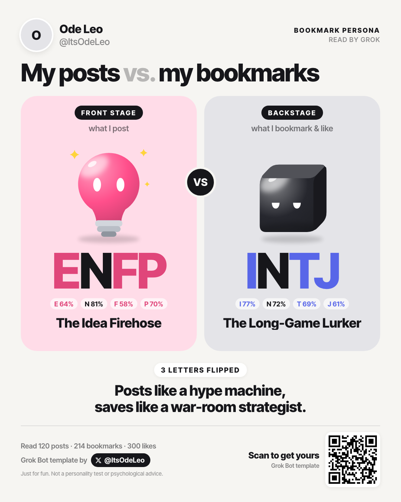
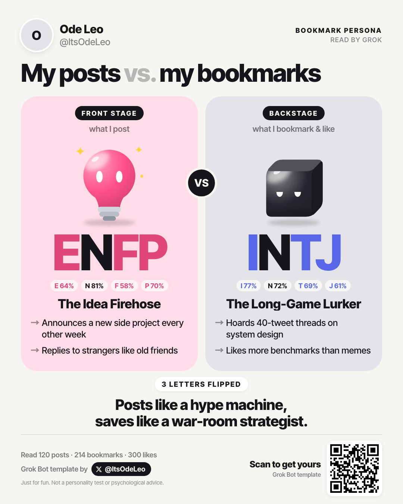
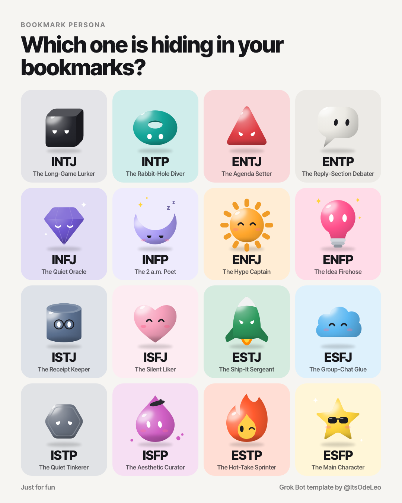

# Bookmark Persona — your X posts vs. your bookmarks

  
  

<strong>Your posts show one persona. Your bookmarks show another.</strong>

If you find it fun, a ⭐ star helps more people find it.

 
Runs in your own Grok Bot · needs the X plugin · your data stays in your Bot

  
  
  

<strong>English</strong> · <a href="README.zh-CN.md">中文</a>

Bookmark Persona is a Grok Bot template, also packaged as a plugin. It reads your X posts (the front stage) against your bookmarks and likes (the backstage) and turns the gap into a share card with two glossy pets.

Unofficial; not affiliated with xAI or X. Just for fun, not a personality test.

## What it does

- **Two personas** — the front stage from your posts and replies, the backstage from your bookmarks and likes. Each gets a four-letter type, one of 16 pets and a nickname.
- **A one-line verdict** — how the two sides differ, such as *"Posts like a hype machine, saves like a war-room strategist."*
- **Two cards, you pick** — the private card shows only types, pets and the verdict; the detailed card adds two lines per side about your themes. A "Post on X" link opens the composer with the text and the template link filled in.
- **English or Chinese** — the card follows the language you write to the Bot in.

## How it reads you

1. **Read.** Through Grok Bot's X plugin, the Bot reads up to 200 of your posts, 300 bookmarks and 600 likes.
2. **Drop the noise.** Follow-for-follow posts, giveaways, bare "gm"s and one-word or single-emoji replies count for nothing.
3. **Tag every item.** Each item gets a pole, or no signal, on four axes. The Bot judges what an item says, never the act itself: posting isn't automatically outgoing, and saving isn't automatically private.

   | Axis | Question |
   |---|---|
   | E / I | Is it turned toward other people, or toward a thought of its own? |
   | S / N | Is it about concrete specifics, or about ideas and patterns? |
   | T / F | Does it run on logic or on feeling? |
   | J / P | Is it settled or still open? |

4. **Count.** Weights: original post 1, reply 0.5, bookmark 2, like 1. Each pole gets 3 extra points first, so a thin axis stays near 50% instead of jumping to 0% or 100%. The letter is the pole above 50%. Under 55%, the card tilts the letter and marks it as on the fence: run it again and it might flip.

## Privacy

- Everything runs in your own Grok Bot. The template's creator never receives your data.
- The card data travels in the URL fragment of a local file and is rendered on your Bot's own computer.
- After each run, the Bot deletes the data it downloaded and saves nothing to memory.
- The cards never quote or name a specific post, bookmark or author.

## Use it

**Grok Bot template** (no install): open [the template](https://x.ai/bot/n-19X3xySPROJG9JTLWAl) in the Grok Bot app, connect the X plugin when it asks, and say *"Make my persona card."*

**Plugin:** this repository is also a skills-only plugin (`.cursor-plugin/plugin.json`, with the skill in `skills/bookmark-persona-card/`). Add it to a Bot that has the X plugin connected, then ask for your persona card.

**Make your own:**

1. Fork this repository and host `card.html`, `persona.js` and `share.txt` somewhere public, such as a gist.
2. Point the URLs in `skills/bookmark-persona-card/SKILL.md` at your copies.
3. Create a Bot in Grok, give it `grok/INSTRUCTIONS.md` as its instructions, install `skills/bookmark-persona-card/SKILL.md` as a skill and connect the X plugin.
4. Use **Create template** in the Bot's menu, then publish it.

Please keep the credit to @ItsOdeLeo on the card. If you publish a changed version, please give it a different name.

## The 16 pets

| Type | Pet | Type | Pet |
|---|---|---|---|
| INTJ | black cube | ISTJ | canister in reading glasses |
| INTP | donut | ISFJ | heart |
| ENTJ | triangle | ESTJ | rocket |
| ENTP | speech bubble | ESFJ | cloud |
| INFJ | gem | ISTP | hex nut |
| INFP | sleepy moon | ISFP | paint drop in a beret |
| ENFJ | sun | ESTP | winking flame |
| ENFP | light bulb | ESFP | star in sunglasses |

## Files

| File | What it is |
|---|---|
| `card.html` | The 1080×1350 card. Data comes in the URL fragment as `#d=<base64url JSON>`; add `"detail": true` for the detailed card. Open `card.html#demo` or `card.html#demo=zh` to preview. |
| `persona.js` | The 16 pets and their nicknames. |
| `gallery.html` | All 16 pets on one image (`#zh` for Chinese). |
| `skills/bookmark-persona-card/SKILL.md` | The skill that reads, scores and renders. |
| `grok/INSTRUCTIONS.md` | The Bot's instructions for the template. |
| `.cursor-plugin/plugin.json` | The plugin manifest; the logo is `assets/logo.png`. |
| `share.txt` | The template link the Bot puts in the share text. |

Grok Bot templates only carry text, so the Bot downloads `card.html`, `persona.js` and `share.txt` from a [public gist](https://gist.github.com/ItsOdeLeo/f9019b6f40436571169eeaca4b481312) on every run. Updating the gist changes every card from the next run on, without republishing the template. The gist mirrors this repository.

## License

- Code: MIT, see [`LICENSE`](LICENSE).
- The 16 pet designs: CC BY-NC 4.0, see [`LICENSE-ART.md`](LICENSE-ART.md).

Four-letter types are used informally. Nicknames and art are original.

## Author

Built by 欧的Leo — [@ItsOdeLeo on X](https://x.com/ItsOdeLeo) · [小红书 ItsOdeLeo](https://xhslink.com/m/18bjTTf180W). Feedback and ideas are welcome there or in [GitHub issues](https://github.com/ItsOdeLeo/bookmark-persona/issues).
