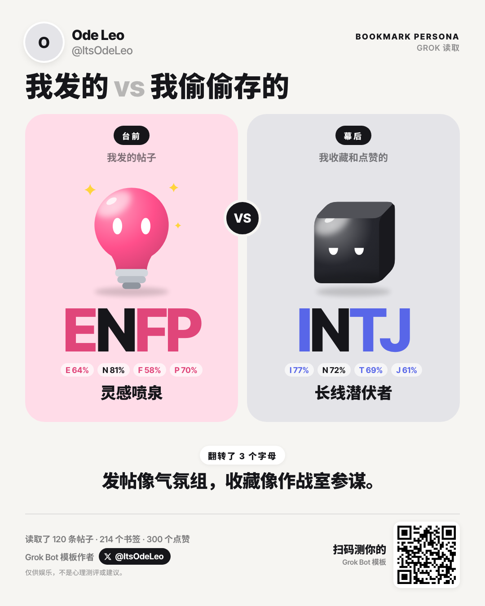
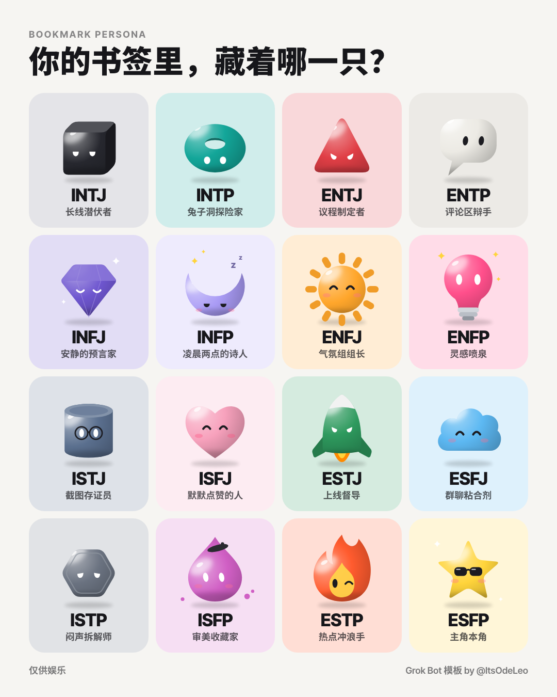

# Bookmark Persona — 你发的帖子 vs. 你的收藏

  
  

<strong>你发的帖子是一个人设，你的收藏是另一个。</strong>

觉得好玩的话，点个 ⭐ 能让更多人看到它。

 
在你自己的 Grok Bot 里运行 · 需要连上 X 插件 · 数据不离开你的 Bot

  
  
  

<a href="README.md">English</a> · <strong>中文</strong>

Bookmark Persona 是一个 Grok Bot 模板，也打包成了插件。它把你在 X 上发的帖子（台前）和你的收藏、点赞（幕后）放在一起对比，把两者的反差做成一张分享卡，上面有两只亮晶晶的小宠物。

非官方工具，与 xAI 和 X 无隶属关系。仅供娱乐，不是性格测试。

## 它能做什么

- **两个人设：** 台前看你发的帖子和回复，幕后看你的收藏和点赞。每一边都有一个四字母类型、16 只宠物中的一只和一个昵称。
- **一句话总结：** 说出两边差在哪，比如“发帖像气氛组，收藏像作战室参谋”。
- **两张卡，你来选：** 私密版只显示类型、宠物和总结；详细版每边再多两行，讲你关注的主题。点“发到 X”会打开发帖框，文案和模板链接都已经填好。
- **中文或英文：** 你用什么语言跟 Bot 说话，卡片就用什么语言。

## 怎么判断的

1. **读取：** 通过 Grok Bot 的 X 插件，读取你最多 200 条帖子、300 条收藏和 600 条点赞。
2. **去掉噪音：** 互关帖、抽奖帖、单独一句 “gm”、只有一个词或一个表情的回复，都不计分。
3. **逐条打标签：** 每一条在四个维度上各判一个方向，或者判为“没有信号”。只看内容本身说了什么，不看发帖或收藏这个动作：发帖不等于外向，收藏也不等于内向。

   | 维度 | 判断的问题 |
   |---|---|
   | E / I | 是朝向别人，还是在想自己的事？ |
   | S / N | 讲的是具体细节，还是想法和规律？ |
   | T / F | 靠逻辑，还是靠感受？ |
   | J / P | 是已经定下来的，还是还开放着？ |

4. **计分：** 权重是原创帖 1、回复 0.5、收藏 2、点赞 1。每个方向先各加 3 分，这样数据少的维度会停在 50% 附近，不会一下跳到 0% 或 100%。超过 50% 的一边就是那个字母。低于 55% 时，卡片会把字母歪过来，标出“在摇摆”：再测一次可能会翻。

## 隐私

- 一切都在你自己的 Grok Bot 里运行，模板作者收不到你的任何数据。
- 卡片数据放在本地文件链接的 `#` 后面，在你的 Bot 自己的电脑上渲染。
- 每次跑完，Bot 会删除下载的数据，也不往记忆里存任何东西。
- 卡片不会引用或点名任何一条帖子、收藏或作者。

## 怎么用

**Grok Bot 模板**（不用安装）：在 Grok Bot App 里打开[模板](https://x.ai/bot/n-19X3xySPROJG9JTLWAl)，按提示连上 X 插件，然后说“给我做 persona 卡片”。

**插件：** 这个仓库也是一个只含技能的插件（`.cursor-plugin/plugin.json`，技能在 `skills/bookmark-persona-card/`）。把它加到连好 X 插件的 Bot 里，然后让它给你做 persona 卡片就行。

**做你自己的版本：**

1. Fork 这个仓库，把 `card.html`、`persona.js` 和 `share.txt` 放到公开的地方，比如 gist。
2. 把 `skills/bookmark-persona-card/SKILL.md` 里的链接换成你的。
3. 在 Grok 里新建一个 Bot，用 `grok/INSTRUCTIONS.md` 作为指令，安装 `skills/bookmark-persona-card/SKILL.md` 这个技能，再连上 X 插件。
4. 在 Bot 的菜单里点 **Create template**，然后发布。

请保留卡片上 @ItsOdeLeo 的署名。如果你发布改过的版本，请换一个名字。

## 16 只宠物

| 类型 | 宠物 | 类型 | 宠物 |
|---|---|---|---|
| INTJ | 黑色立方体 | ISTJ | 戴眼镜的小罐子 |
| INTP | 甜甜圈 | ISFJ | 爱心 |
| ENTJ | 三角形 | ESTJ | 火箭 |
| ENTP | 对话泡泡 | ESFJ | 云朵 |
| INFJ | 宝石 | ISTP | 六角螺母 |
| INFP | 犯困的月亮 | ISFP | 戴贝雷帽的颜料滴 |
| ENFJ | 太阳 | ESTP | 眨眼的小火苗 |
| ENFP | 灯泡 | ESFP | 戴墨镜的星星 |

## 文件

| 文件 | 是什么 |
|---|---|
| `card.html` | 1080×1350 的卡片。数据放在链接的 `#d=<base64url JSON>` 里；加上 `"detail": true` 就是详细版。打开 `card.html#demo` 或 `card.html#demo=zh` 可以预览。 |
| `persona.js` | 16 只宠物和它们的昵称。 |
| `gallery.html` | 16 只宠物的合集图（加 `#zh` 是中文版）。 |
| `skills/bookmark-persona-card/SKILL.md` | 负责读取、打分和出图的技能。 |
| `grok/INSTRUCTIONS.md` | 模板里 Bot 的指令。 |
| `.cursor-plugin/plugin.json` | 插件清单文件；logo 是 `assets/logo.png`。 |
| `share.txt` | Bot 放进分享文案里的模板链接。 |

Grok Bot 模板只能带文字，所以 Bot 每次运行都会从一个[公开 gist](https://gist.github.com/ItsOdeLeo/f9019b6f40436571169eeaca4b481312) 下载 `card.html`、`persona.js` 和 `share.txt`。更新 gist 后，下一次运行就会用上新卡片，不用重新发布模板。gist 和这个仓库内容一致。

## 许可

- 代码：MIT，见 [`LICENSE`](LICENSE)。
- 16 只宠物的设计：CC BY-NC 4.0，见 [`LICENSE-ART.md`](LICENSE-ART.md)。

四个字母只是借用的说法，昵称和图都是原创。

## 作者

由欧的Leo 制作 — [X：@ItsOdeLeo](https://x.com/ItsOdeLeo) · [小红书：ItsOdeLeo](https://xhslink.com/m/18bjTTf180W)。欢迎在这两个地方或 [GitHub issues](https://github.com/ItsOdeLeo/bookmark-persona/issues) 留反馈和想法。
